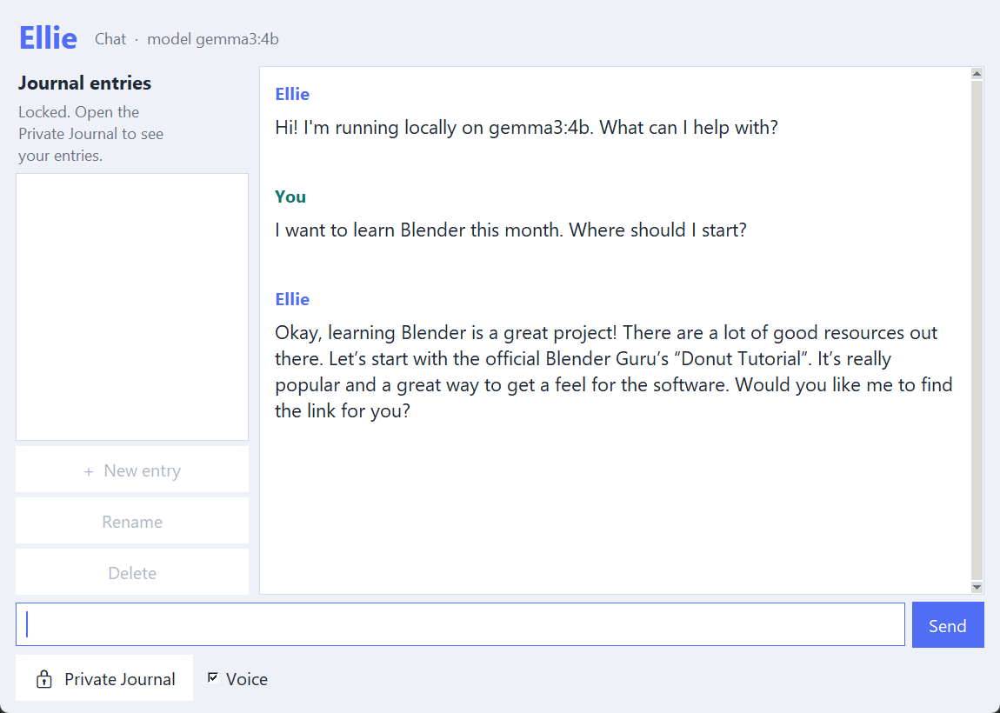

# Ellie

A private, offline AI assistant for Windows. Ellie runs entirely on your own computer: a local language model through [Ollama](https://ollama.com), a natural American voice through [Piper](https://github.com/rhasspy/piper), and a simple desktop window built with tkinter. Nothing is sent to the cloud.

## Features
- **Chat** in a clean desktop window, or in the terminal.
- **Voice**: replies are spoken aloud offline (Piper `en_US-lessac-medium`, from Piper's v0.0.2 GitHub release), with a Windows voice as a fallback. Code blocks are skipped instead of read aloud.
- **Memory**: a facts file you edit, plus a short summary of the last chat that Ellie writes herself when you close the window.
- **Privacy: the Private Journal**. A password-locked journal for personal writing, with Ellie as a reflective listener.
  - Encrypted at rest: PBKDF2-HMAC-SHA256 (600,000 rounds, random salt) derives a key for Fernet (AES + HMAC) from the `cryptography` package.
  - The password is never stored. Without it, the file can't be read by anyone, Ellie included.
  - While the journal is open, conversations are saved only inside it: no plain-text transcript, no summary, and nothing is spoken aloud.
  - Locking it (or closing the window) saves, clears the screen and forgets the contents from memory.

## Files
| File | Job |
|---|---|
| `EllieChat.py` | The brain: personality, memory, and the call to Ollama. Runs a terminal chat on its own. |
| `EllieDesktop.py` | The desktop window. |
| `ellie_journal.py` | The encrypted Private Journal. |
| `ellie_voice.py` | Text to speech. |
| `data/` | Local memory and the encrypted journal (created on first run, never uploaded). |

## Setup
1. Install [Ollama](https://ollama.com) and a model: `ollama pull gemma3:4b`
2. Python 3.9+ with: `pip install -r requirements.txt`
3. For the voice, put Piper's Windows build in `piper\` and the voice files (`.onnx` + `.onnx.json`) in `voices\`.
4. Run `python EllieDesktop.py` (or `pythonw` for no console window).

## Settings
- **Your name**: `data/settings.json` (created on first run), e.g. `{"user_name": "Sam"}`. It stays on your computer.
- **Model**: `PREFERRED_MODEL` at the top of `EllieChat.py`.
- **What Ellie knows about you**: `data/facts.md`, one fact per line.
- **Voice speed and expression**: the settings at the top of `ellie_voice.py`.

## License
MIT. See [LICENSE](LICENSE).
